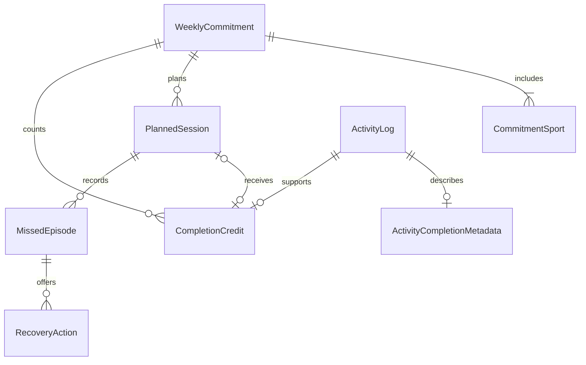

# Schema dự thảo và state transition contract

**Không phải migration thực thi.** Áp dụng cùng [ADR-001](adr-001.md), mọi giá trị
policy còn chờ duyệt. SQLite là nguồn chuẩn; tên snake_case là tên dự kiến.

## Entity và constraints

Mọi entity mới có UUID ổn định, `owner_id`, `schema_version`, `revision >= 1`,
`created_at_utc`, `updated_at_utc`. Unique `(owner_id,id)` làm composite FK; ownership
không được sửa. Timestamps UTC, dates ISO; enum có CHECK, FK bật trên mọi connection.
Không hard-delete activity/commitment trong luồng correction.

Diagram biểu diễn active credit; correction history nằm trong DomainChange và
metadata revisions. Notification/outbox không là nguồn tính progress.

| Entity | Trường đặc thù | Cardinality / constraints |
|---|---|---|
| WeeklyCommitment | id, local_week_start, timezone_iana, starts_at_utc, ends_at_utc, target_at_start, policy_version, partial_week, transition_week, status, next_target, next_sports, finalized_at | Một owner nhiều tuần; unique owner + local_week_start; transaction không cho UTC periods overlap; end > start; target và next_target 1–7; snapshot immutable; status active/closed |
| CommitmentSport | commitment_id, sport_code | Một commitment có 1..8 môn, unique owner + commitment + sport; sport code dùng enum hiện hữu |
| PlannedSession | id, commitment_id, credit_root_id, sport_code, planned_start/end_utc, local_scheduled_time, timezone, resolved_offset, schedule_revision, state, mode, carried_from_session_id, last_missed_episode_id | Commitment 0..N sessions (không ép N = target); unique root/session; thời gian trong kỳ; mode normal/short; carried_from FK cùng owner, cấm vòng lặp |
| ActivityLog v2 | id, owner_id, activity_type, minutes, created_at_utc, local_date | Giữ nguyên toàn bộ trường và semantics cũ; minutes >0; id PK; không đổi localDate cũ khi travel |
| ActivityCompletionMetadata | activity_id, completed_at_utc, recorded_at_utc, actual_start_utc, policy_version, validity, corrected_by, voided_at | ActivityLog có 0..1 metadata; legacy không có metadata không nhận credit tự động; validity valid/below_threshold/outside_period/void; recorded_at giữ thời điểm ghi |
| CompletionCredit | id (= credit_root_id), commitment_id, session_id nullable, activity_id, valid, credited_at, revision | Activity chỉ tối đa 1 active credit; session chỉ tối đa 1 active credit; standalone root riêng; credit FK cùng owner; sửa hoạt động thay link trong cùng root, không insert credit thứ hai |
| MissedEpisode | id, session_id, schedule_revision, deadline_at, detected_at, retracted_at, superseded_by | Một session có nhiều episode sau nhiều lần dời; unique owner + session + schedule_revision; deadline/event được persist để retry không nhân đôi |
| RecoveryAction | id, missed_episode_id, source_session_id, kind, selected_at, outcome, completed_at nullable, resulting_schedule_revision, linked_activity_id nullable, destination_session_id nullable, supersedes_action_id | Episode có 0..N action revisions, chỉ 1 action active; kind reschedule/short/rest; rest detail health chỉ local; outcome pending/fulfilled/acknowledged/superseded/cancelled; activity fulfillment FK cùng owner |
| CommandReceipt | command_id, owner_id, payload_hash, result_entity_id, result_revision | Unique owner + command_id; cùng command khác hash conflict; ghi cùng transaction domain |
| DomainChange | id, entity_type/id/revision, command_id, before_state, after_state, correction_reason enum | Audit local tối thiểu để undo/correction, không copy health notes; unique entity revision |
| AnalyticsConsent | owner_id, subject_id, enabled, generation, updated_at, deletion_pending | Một owner/installation; subject UUID ngẫu nhiên riêng, không hash email; revocation tăng generation |
| AnalyticsOutbox | event_id, schema_version, event_name, subject_id, consent_generation, occurred_at, recorded_at, entity_revision, envelope_json, attempt_count, next_attempt_at, lease_until, acked_at | event_id PK; unique semantic dedup key; finite allowlist payload; retry giữ event_id; không FK cascade xóa journal khi purge analytics |
| NotificationIntent | owner_id, session_id, kind, native_id, desired_revision, fire_at_utc, timezone, enabled, applied_revision | unique native_id toàn installation; unique owner + session + kind; persisted desired state để sửa sai sau crash |

Một completed activity độc lập với planned session. Không tạo ActivityLog khi chỉ
schedule/rest. Một session dùng nguyên ID/root khi đổi giờ hoặc chọn short; “replacement”
là mode/revision thay thế nội dung dự kiến, không nhân bản session. Qua tuần mới là
session/root khác và không bù tuần cũ.

Credit allocation: validate owner → load commitment/policy → check command receipt →
check expected revision → validate interval/threshold → insert ActivityLog và metadata →
allocate/update root credit → update session/recovery → persist outbox nếu consent → commit.
Double-tap với UUID activity khác vẫn bị unique root chặn; transaction rollback log thừa.
Log tự do cần command receipt riêng; crash-retry dùng ID cũ. Overlapping actual intervals
giữa credits bị từ chối, người dùng có thể giữ log không credit hoặc sửa thời gian.

## State transition table

States persisted: `planned`, `missed`, `completed`, `rested`, `cancelled`.
“Rescheduled”/“shortened” là action + mode/revision, không là terminal state.

| ID | From → To | Trigger / guard | Atomic effects và reminder |
|---|---|---|---|
| ST01 | none → planned | Schedule vào commitment đang sửa được | Session/root mới, schedule event; desired reminder |
| ST02 | planned → planned | Edit trước deadline, expected revision đúng | Revision tăng, giữ root/target; thay reminder; không missed event |
| ST03 | planned → missed | now ≥ deadline, chưa valid credit | Episode unique; missed event có deadline; recovery eligible nếu không health pause |
| ST04 | missed → planned | Reschedule trong kỳ tới giờ tương lai | RecoveryAction pending, revision mới, root cũ; cancel stale reminder |
| ST05 | missed → planned | Chọn short trước actual start, ≥5 phút đề xuất | Mode short, revision mới, action pending; root/target không đổi |
| ST06 | planned/missed → completed | Valid actual activity cùng kỳ, chưa credit | Activity + credit + completion event; action fulfilled nếu activity sau selection, cancel reminder |
| ST07 | planned/missed → same | Log dưới threshold/ngoài kỳ | Lưu activity non-credit, không completion event, không giả progress |
| ST08 | planned/missed → rested | Rest intentional/health được xác nhận | Action acknowledged, không activity/credit; cancel session; health pause toàn owner |
| ST09 | planned → cancelled | Người dùng bỏ lịch | Không giảm target; cancel reminder; lịch sử giữ lại |
| ST10 | missed → cancelled | Người dùng bỏ lịch sau miss | Giữ missed episode thật, không xóa mẫu số; cancel reminder |
| ST11 | completed → planned/missed | Undo completion trước cutoff | Void credit + correction event; chọn state theo clock; recompute KPI, không phát completion lần hai |
| ST12 | rested/cancelled → planned/missed | Explicit undo | Ghi audit; theo clock; health pause không tự clear; episode cũ không phát lại |
| ST13 | missed/completed → completed | Backdate chứng minh actual end ≤ deadline | Credit nếu chưa có; retract episode sai + correction event; không tính return sau miss bị retract |
| ST14 | completed → completed | Sửa giờ/môn/phút vẫn valid | Metadata/credit revision + correction event; không event session_completed mới |
| ST15 | completed → planned/missed | Correction làm activity invalid | Void credit, audit giữ; missed episode mới chỉ nếu chưa có cho revision này |
| ST16 | missed/cancelled → unchanged + new planned | Dời qua week boundary | Tạo session ở commitment mới và trace nguồn; không chuyển credit/target cũ |
| ST17 | planned → missed; commitment active → closed | Rollover/reconcile | Mỗi deadline đến hạn xử lý một lần; không tự tạo commitments các tuần vắng |

ST11/14/15 sau cutoff vẫn chỉnh journal và local current projection nhưng báo cáo
KPI frozen giữ snapshot; correction phải mang `affects_finalized_metrics=false`.
Session terminal được tap complete lần nữa: trả receipt/credit hiện có, không sinh event.
Undo rồi complete lại dùng root cũ, tăng revision; projection dựa active credit, không
đếm raw số event. `session_completion_corrected` biểu diễn những thay đổi sau lần đầu.

Rest → activity về sau cần explicit undo trước linking; không âm thầm sửa rest thành
completed. Recovery reschedule/short chỉ fulfilled khi linked valid activity thực tế
sau selection; đổi lựa chọn thì action cũ superseded. Rest acknowledged tại commit,
không tính “recovery workout completed”. Có thể có nhiều missed episodes/session;
KPI primary dùng episode đầu hợp lệ mỗi subject/week để tránh người miss nhiều lấn mẫu.

## Ví dụ biên phải kiểm thử

- Target 3, hai buổi hợp lệ cùng ngày ⇒ 2/3, không 1/3 theo activeDays.
- Target 3, bốn credit ⇒ 100%, vẫn hiển thị bốn hoạt động thực tế.
- Chủ nhật 23:00 end, grace bị cap Monday 00:00; log Monday 09:00 nhưng actual end
  Sunday 23:30 thuộc tuần cũ, late sau planned end nhưng trước capped deadline.
- Chạy Monday 00:10 cho buổi Sunday: không link credit vào tuần cũ; có thể log tuần mới.
- App đóng ba ngày: reconcile ghi deadline cũ và detected_at hiện tại; không gửi loạt nhắc bù.
- Retry selection sau restart: một action và một event. Hai action khác concurrent:
  CAS thắng một; command còn lại refresh, không silently overwrite.
